# DIS 1 · Estudio de uso en el gimnasio

Primera entrega de la fase D del plan v2 (`docs/plan-v2.md` en la etiqueta `plan-v2`). Describe cómo y dónde se usa Pipos Fitness, qué tiene que leerse en cada pantalla, qué falla hoy y qué requisitos medibles heredan el sistema de diseño (DIS 3), los prototipos (DIS 4) y la implementación (fase 5).

**Estado:** borrador pendiente del diario de uso. Se acepta cuando Víctor y Virginia confirmen que describe lo que les pasa de verdad.

---

## Índice

0. [Cómo leer este documento](#0-cómo-leer-este-documento)
1. [Objetivo y método](#1-objetivo-y-método)
2. [Para qué se usa la app](#2-para-qué-se-usa-la-app)
3. [Recorrido de la semana y de la sesión (HIPÓTESIS)](#3-recorrido-de-la-semana-y-de-la-sesión-hipótesis)
4. [Jerarquía por pantalla](#4-jerarquía-por-pantalla)
5. [Inventario de problemas de la app actual](#5-inventario-de-problemas-de-la-app-actual)
6. [Requisitos medibles](#6-requisitos-medibles)
7. [Hipótesis principales y preguntas abiertas](#7-hipótesis-principales-y-preguntas-abiertas)
8. [Siguientes pasos](#8-siguientes-pasos)

---

## 0. Cómo leer este documento

Cada afirmación lleva una marca de dónde sale:

| Marca | Significa | De dónde sale |
|---|---|---|
| **[OBS]** | Observado en la app | Auditoría de uso con Playwright, sus 120 capturas o la lectura del código de `diseno-prototipos` (igual que `pipos-v2`) |
| **[PLAN]** | Decidido en el plan aprobado | `docs/plan-v2.md`, fase D y decisiones D1-D15 |
| **[HIP]** | Hipótesis de diseño | Razonamiento sobre el contexto descrito (gimnasio y piscina, una mano, entre series, a veces sin cobertura). **No está observado**: lo confirma o lo tumba el diario |
| **[P-n]** | Pregunta abierta n | Sección 7; la responde el diario |

No hay en este documento ninguna cita, dato ni costumbre de Víctor o Virginia. Lo que parezca un hábito suyo es una hipótesis y está marcado como tal. Los datos que se ven en las capturas (lesión de rodilla, nombres de días, kilos) son **datos de ejemplo** sembrados por la auditoría, no los reales.

---

## 1. Objetivo y método

### Objetivo

Que el rediseño parta de cómo se usa la app de pie en el gimnasio, y no de cómo se ve en un escritorio. En concreto:

1. Saber qué necesita ver y hacer cada persona en cada momento de la semana y de la sesión.
2. Fijar qué debe leerse en 1 s, en 5 s y qué puede quedar a un toque en cada pantalla.
3. Convertir los hallazgos de uso de la auditoría en una lista de cosas que el rediseño tiene que resolver.
4. Dejar requisitos que se puedan medir con un script, no por opinión.

### Método

| Fuente | Qué aporta | Estado |
|---|---|---|
| Auditoría de uso (noviembre de 2026) | 14 scripts de Playwright, 120 capturas de la app actual (iPhone 13 emulado a 390×664, 360×640, 320×568, horizontal, texto al 200 % y movimiento reducido), medidas de contraste, posiciones y tamaños de los controles | Hecha. 20 hallazgos de uso confirmados y 2 de pérdida de datos que afectan al uso |
| Lectura del código de las pantallas | `js/areas/*/indice.js`, `js/areas/sesion/temporizador.js`, `css/*.css`: qué enseña cada pantalla, en qué orden y qué hace cada botón | Hecha |
| Plan aprobado | Requisitos de partida de DIS 1 y criterio T9 | Hecho |
| **Diario de uso** | Lo que pasa de verdad: cuándo se saca el móvil, dónde está entre series, qué se mira, qué sobra y qué falta, luz, manos, auriculares, cobertura | **Pendiente**: 3-4 sesiones reales de cada uno con `diario-plantilla.md` |

Proceso: recorrido por momentos (skill de *journey mapping*: postura, atención, manos, entorno, emoción y puntos de fricción) → jerarquía por pantalla → hallazgos ordenados por momento → requisitos con su medida → preguntas que el diario debe responder. Cuando lleguen los diarios se sintetizan (agrupar por temas, separar observación de interpretación, contar «de las N sesiones, en X…») y se actualiza la columna «Estado» de la tabla de hipótesis (sección 7).

### Límites (léelos antes de sacar conclusiones)

- **Dos usuarios.** No es una muestra: no se puede hablar de «la mayoría» ni de porcentajes que generalicen. Lo que vale para uno puede no valer para el otro, y está bien diseñar para los dos casos.
- **Los usuarios también aprueban.** Víctor y Virginia rellenan el diario y aprueban el diseño. Hay riesgo de contar lo que creen que se espera o de suavizar lo que molesta. La plantilla pregunta por hechos concretos («¿dónde estaba el móvil?») antes que por opiniones.
- **Diario autoinformado y a posteriori.** Se rellena después de la sesión, no durante: se olvidan los detalles pequeños (un toque fallido, cuántas veces se miró la pantalla). No sustituye a la observación; sirve para validar o tumbar hipótesis gruesas.
- **3-4 sesiones por persona.** Puede que no salgan los casos raros (piscina, sin cobertura, máquina ocupada). Lo que no salga sigue como hipótesis.
- **Emulación no es gimnasio.** Las capturas se hicieron en un navegador emulado: no reproducen el brillo, los reflejos, el sudor en la pantalla ni el ruido. Los contrastes medidos son los del código, no los percibidos bajo los fluorescentes.
- **Sin analítica de uso.** La app no mide nada (y no debe: es privada). No hay frecuencias reales de uso por pantalla.

---

## 2. Para qué se usa la app

**Quién [OBS]:** dos personas, cada una con su móvil y la app instalada en la pantalla de inicio; cada una ve solo lo suyo. Un entrenador IA (o las reglas, si falla) crea el plan semanal y ajusta la sesión del día con un check-in.

**Trabajo principal [HIP]:** «Cuando estoy en el gimnasio, quiero saber qué toca ahora y dejar apuntado lo que hago sin pensar, para que el entrenador ajuste lo siguiente y yo vea que avanzo.»

Trabajos secundarios [HIP]:

- «Antes de ir, quiero saber qué voy a hacer y cuánto me va a llevar, para organizarme.»
- «Cuando me duele algo o vengo cansado, quiero que la sesión se adapte sin tener que explicarlo todo.»
- «De vez en cuando, quiero ver que soy constante y que muevo más peso.»
- «Si no sé hacer un ejercicio, quiero verlo en el momento sin perder el sitio.»

Consecuencia de diseño: la sesión es el núcleo. Hoy, el check-in y el descanso son las pantallas que se usan en peores condiciones; Progreso, Perfil y Ejercicios se usan en calma (hipótesis H6).

---

## 3. Recorrido de la semana y de la sesión (HIPÓTESIS)

> **Todo este apartado es HIPÓTESIS a validar con el diario.** Describe condiciones probables a partir del contexto conocido (centro deportivo con gimnasio y piscina climatizada; uso de pie, con una mano, entre series, con manos sudadas y a veces sin cobertura). No describe lo que Víctor o Virginia hacen: eso lo dirá el diario. Cada fila remite a las preguntas [P-n] que la confirman o la tumban.

### 3.1 Mapa de entrada

```
[Icono en la pantalla de inicio] ──→ Hoy ──→ (Empezar) ──→ Check-in ──→ Espera IA ──→ Sesión
[Volver a la app tras bloquear] ──→ la pantalla donde estaba (sesión / descanso en marcha)
[Notificación del sistema]  ── no existe hoy (la PWA no notifica); la alarma de descanso es sonido + vibración
                                                   │
Sesión ──→ serie ──→ descanso ──→ alarma ──→ siguiente serie … ──→ estiramientos ──→ Terminar ──→ Cierre ──→ Hoy
   │                                                                         │
   ├─→ Cómo se hace (ficha, vídeo)                                           └─→ (noche) Progreso / Perfil / plan semanal
   └─→ Menú del ejercicio ──→ Cambiar por otro (máquina ocupada) / añadir o quitar serie / comentario
Error de la IA ──→ sesión o plan hechos por la app (con aviso)      Sin cobertura ──→ todo funciona menos la IA
```

### 3.2 Condiciones de cada momento

Atención disponible: **mínima** (miradas de 1-2 s), **parcial** (unos segundos, entre otras cosas), **plena** (sentado, sin prisa).

| # | Momento | Postura | Atención | Manos | Luz | Ruido | Cobertura | Emoción probable | Preguntas |
|---|---|---|---|---|---|---|---|---|---|
| M1 | Semana: domingo o lunes, en casa | Sentado o tumbado | Plena | Dos, secas | Interior, quizá de noche | Bajo | Buena (wifi) | Planificar, algo de pereza | P-1 |
| M2 | En casa antes de salir | De pie, moviéndose | Parcial | Una; la otra con la bolsa | Interior | Bajo | Buena | Prisa | P-1, P-2 |
| M3 | Camino o en la calle | Andando | Mínima | Una | Exterior, sol directo posible | Medio-alto | Variable | Indiferente | P-2 |
| M4 | Vestuario | De pie, cambiándose | Mínima-parcial | Una, a ratos ninguna | Interior, a veces pobre | Medio | Mala o nula (sótanos, muros) | Ganas o desgana | P-2, P-8 |
| M5 | Entrada al gimnasio: check-in y calentamiento | De pie, quieto o moviéndose | Parcial | Una | Fluorescentes, reflejos | Alto (música, máquinas) | Mala posible | Decidir cómo viene el día | P-3, P-8 |
| M6 | Durante la serie y justo al acabarla | En la máquina, de pie o tumbado | Ninguna durante; mínima al acabar | Sudadas, quizá con agarres o tiza | Fluorescentes | Alto | Indiferente (todo local) | Esfuerzo, cansancio | P-4, P-5, P-6 |
| M7 | Descanso entre series | De pie o sentado en la máquina | Parcial, interrumpida | Una, sudada | Fluorescentes | Alto; auriculares posibles | Indiferente | Recuperar, mirar el móvil | P-4, P-7 |
| M8 | Máquina ocupada | De pie, buscando alternativa | Parcial, con prisa | Una | Fluorescentes | Alto | Indiferente | Fastidio | P-9 |
| M9 | Cardio (bici, cinta, elíptica) | Sobre la máquina, moviéndose | Mínima | El móvil quizá apoyado en la máquina | Fluorescentes | Alto | Indiferente | Rutina, aburrimiento | P-10 |
| M10 | Piscina | En el agua o en el borde | Ninguna en el agua | Mojadas | Cubierta, humedad, reflejos | Alto (eco) | Indiferente | Concentración | P-11 |
| M11 | Estiramientos y vuelta a la calma | En el suelo o en la colchoneta | Parcial | Dos, cansadas | Fluorescentes | Medio | Indiferente | Ganas de acabar | P-12 |
| M12 | Después: cierre y vestuario | De pie o sentado | Parcial | Una o dos | Interior | Medio | Mala posible | Satisfacción, prisa | P-13 |
| M13 | En casa por la noche | Sentado o tumbado | Plena | Dos, secas | Interior, poca luz | Bajo | Buena | Curiosidad, revisar | P-14 |

### 3.3 Qué necesita ver y hacer en cada momento

| # | Necesita ver | Necesita hacer | Riesgo principal | Problemas de hoy (sección 5) |
|---|---|---|---|---|
| M1 | Qué días toca y qué, cuánto dura cada día, por qué | Marcar días, minutos y lugares; pedir el plan a la IA; reorganizar si cambia algo | Esperar 20-90 s sin saber si va bien; error técnico; perder lo pedido | P05, P06 |
| M2 | Qué toca hoy, en qué sitio (gimnasio o piscina, para la bolsa) y cuánto tiempo | Nada, o «Hoy no puedo» | Que el dato de minutos no cuadre con lo que luego se hace | P08 |
| M3 | Lo mismo que M2, de un vistazo | Nada | Sol directo: textos tenues ilegibles | P20 |
| M4 | Que la sesión de hoy está lista y funciona sin red | Abrir la sesión o hacer el check-in sin cobertura | Llegar sin red y que la IA no responda; quedarse esperando | P05, P06 |
| M5 | Cómo viene el día (energía, dolor) y qué cambia con ello | Check-in en 3-4 toques; empezar; marcar calentamiento | Check-in que salta arriba a cada toque; teclado; chips que se mueven | P04, P09, P10, P23 |
| M6 | El ejercicio, la serie que toca, kilos y repeticiones objetivo | Marcar la serie con los mismos kilos en 1 toque; cambiar kilos o repeticiones en ≤ 3 | Teclear kilos en cada serie; serie fuera de pantalla; zonas táctiles pequeñas | P11, P12, P13, P14, P20, P21 |
| M7 | Cuánto queda de descanso y cuál es la siguiente serie | Nada; quizá ±15 s o saltar | Barra que tapa la serie siguiente; alarma ilegible que pide un toque | P15, P16 |
| M8 | Alternativas válidas para el mismo músculo con lo que hay libre | Cambiar el ejercicio o el orden sin perder lo hecho | «Cambiar por otro» borra series hechas | P17 |
| M9 | Tiempo que lleva y que falta, en minutos | Empezar, pausar, terminar | Contador de plancha («objetivo 480 s», «Aguanta») | P18 |
| M10 | Antes de entrar: qué series o metros toca. En el agua: nada | Apuntar después, de golpe | Pedir interacción con las manos mojadas; [HIP] el móvil se queda en la taquilla | P-11 (sin datos aún) |
| M11 | Qué estiramiento toca y cuánto | Marcar como hecho | Lista larga; pasos actuales que no se distinguen | P13, P20 |
| M12 | Qué queda pendiente; resumen de lo hecho | Cerrar con esfuerzo y dolor; comentario opcional | «Terminar» sin avisar de lo pendiente; «Guardar» que no guarda tras el botón atrás; sesión que desaparece a medianoche | P03, P22, P24, P25 |
| M13 | Constancia, fuerza, dolor; la semana que viene | Revisar, ajustar perfil, lesiones, medidas | Cifras que no cuadran entre pantallas; chips de Perfil cortados; jerga | P08, P10, P26 |

### 3.4 Fricciones y momentos de satisfacción

**Fricciones (con su mitigación):**

- **M6, apuntar la serie:** es el gesto que más se repite (una sesión de 6 ejercicios tiene ~18-24 series). Mitigación: kilos y repeticiones que pasan a la serie siguiente, selector ± y marcar con un toque grande en la zona del pulgar (R04, R05).
- **M7, fin del descanso:** el aviso debe llegar sin mirar (sonido o vibración) y leerse sin tocar. Mitigación: alarma legible que se cierra sola y deja a la vista la siguiente serie (R08, R09).
- **M5, check-in:** cada toque que reordena la pantalla obliga a volver a buscar. Mitigación: actualizar en su sitio (R15).
- **M1 y M5, la espera de la IA:** 20-90 s sin progreso ni salida. Mitigación: progreso, «Cancelar» y vuelta segura a lo que había (R13, R14).
- **M8, máquina ocupada:** decisión con prisa y con lo hecho en juego. Mitigación: confirmar con lo que se pierde, o mejor no perderlo (R17).

**Momentos de satisfacción [HIP]:**

- Marcar la última serie de un ejercicio: confirmación inmediata y paso solo al siguiente (ya existe el avance automático en «Uno a uno»).
- Récord personal detectado al marcar la serie (dato que la app ya calcula en Progreso): celebrarlo en el momento, no solo por la noche.
- Cierre: resumen breve (series, kilos totales, constancia de la semana) y una celebración que se puede saltar y respeta el movimiento reducido [PLAN].
- Recordar los kilos de la vez anterior como valor de partida: la app «sabe» lo que hiciste.

### 3.5 Caminos alternativos y de error

| Situación | Qué debe pasar | Hoy [OBS] |
|---|---|---|
| Primera vez (sin perfil) | Bienvenida → elegir quién eres → perfil mínimo → montar la semana. El estado vacío es la presentación | Funciona; Perfil largo y con chips cortados (P26) |
| Sesión de ayer sin cerrar | Hoy la enseña y ofrece cerrarla o descartarla | Desaparece a medianoche (P24) |
| Sin cobertura | Todo funciona salvo la IA; lo que necesita red se ve desactivado con su motivo | Funciona; los avisos de la IA son técnicos (P05) |
| La IA falla | Mensaje llano que se queda hasta que se lee, la petición se conserva y se ofrece reintentar o hacerlo con la app | Mensaje técnico, 3,2 s, petición perdida (P05) |
| Se bloquea el móvil en un descanso | Al volver, el descanso sigue en su sitio y suena al acabar | Funciona (audio programado y estado guardado) [OBS] |
| Se recarga la app en medio | Vuelve a la misma sesión y al mismo paso | El temporizador se recupera; el sonido necesita otro toque tras recargar (plan, PR 15) |
| Botón atrás del sistema con una hoja abierta | Cierra la hoja, no sale de la pantalla | No cierra la hoja; en el cierre, «Guardar» dice guardado y no guarda (P03, P25) |

---

## 4. Jerarquía por pantalla

Regla general: **1 s** es lo que se lee con una mirada de reojo, a un brazo, con sudor en la pantalla; **5 s** es lo que se lee si se mira a propósito; **a un toque** es lo que puede quedar plegado o en otra pantalla. Cada pantalla tiene **una** acción principal, en el tercio inferior (R07).

### Bienvenida

| Nivel | Contenido |
|---|---|
| 1 s | Nombre de la app y «¿Quién eres?» con dos botones grandes: Víctor / Virginia |
| 5 s | Una línea de qué hace la app («Tu entrenador te prepara cada sesión y la ajusta a cómo vienes») |
| A un toque | Cargar una copia de seguridad |
| **Acción principal** | Elegir persona |

Notas: se ve una vez por móvil; el color de la persona empieza aquí y acompaña toda la app [PLAN, D11].

### Hoy

| Nivel | Contenido |
|---|---|
| 1 s | Qué toca hoy (nombre del día o «Descanso») y el botón **Empezar / Seguir** |
| 5 s | Dónde (gimnasio / piscina / casa), cuánto dura (una sola cifra coherente), por qué en una frase, la semana (qué días hechos, cuál hoy, cuáles pendientes, también sin color) |
| A un toque | Detalle del plan semanal y sus razones, «Hoy no puedo», cambiar días, reorganizar, constancia |
| **Acción principal** | Empezar (o Seguir si hay sesión en marcha) |

Variantes: sin perfil (completar perfil); sin plan (montar la semana); sesión en marcha (progreso de la sesión + Seguir); sesión sin cerrar de un día anterior (cerrarla o descartarla); hecha (resumen y lo siguiente); descanso (qué toca después; «Entrenar igualmente» como secundaria); sin conexión (aviso discreto, nada bloqueado salvo la IA).

Hoy [OBS]: el botón Empezar queda en mitad de la tarjeta, la tira de la semana distingue estados solo por color y relleno, y el plan semanal ocupa más que el día de hoy (captura 01).

### Check-in («Antes de empezar»)

| Nivel | Contenido |
|---|---|
| 1 s | Qué toca y el botón **Preparar mi sesión** |
| 5 s | Energía (5 opciones), dolor de las zonas con lesión activa, tiempo y lugar ya rellenos con lo previsto; la vista previa: «con lo que me dices cambia X» y los minutos resultantes |
| A un toque | Otras zonas de dolor, petición libre al entrenador, forzar la IA |
| **Acción principal** | Preparar mi sesión |

Notas: los valores por defecto tienen que ser buenos para que el caso normal sea **un toque** (H3). La vista previa se actualiza en su sitio (R15). La petición libre no abre el teclado sola (R23).

### Espera de la IA (dentro del check-in o del plan)

| Nivel | Contenido |
|---|---|
| 1 s | Que está trabajando y cuánto falta, más o menos (progreso real o por etapas) |
| 5 s | Qué está haciendo («revisando tu rodilla», «eligiendo ejercicios»), y que sin respuesta se hará con la app |
| A un toque | **Cancelar** (vuelve al check-in con todo lo que había) |
| **Acción principal** | Ninguna: esperar. «Cancelar» visible pero secundaria |

### Sesión (modo uno a uno y modo lista)

| Nivel | Contenido |
|---|---|
| 1 s | Nombre del ejercicio, **la serie que toca** con kilos y repeticiones en cifras grandes (≥ 28 px) y el botón de marcarla |
| 5 s | Series hechas y pendientes de este ejercicio, objetivo (series × reps, descanso), lo que hiciste la última vez, en qué parte de la sesión estás (n de m) |
| A un toque | Cómo se hace (pasos, vídeo, errores), la razón del ejercicio, el porqué del día, el menú (cambiar, añadir o quitar serie, opinar, comentar), el resto de ejercicios |
| **Acción principal** | Marcar la serie (con los mismos kilos: 1 toque) |

Notas: durante la serie no se mueve nada salvo el contador [PLAN]. En 320×568 tienen que caber el nombre, el objetivo y la serie actual sin desplazarse (R03). La sesión hecha se abre en modo lectura (R17). «Terminar» es secundaria hasta que todo está hecho.

Hoy [OBS]: entre el nombre y la primera serie hay insignia, objetivo, dos notas y «Cómo se hace» desplegado con vídeo (capturas 05 y 06).

### Descanso (barra y alarma)

| Nivel | Contenido |
|---|---|
| 1 s | Tiempo que queda (cifra grande) y, al acabar, «¡Siguiente serie!» bien legible |
| 5 s | Cuál es la siguiente serie (n de m, kilos) o el siguiente ejercicio |
| A un toque | −15 / +15 s, saltar |
| **Acción principal** | Ninguna obligatoria: el descanso acaba solo y la alarma se cierra sola |

Notas: la barra no puede tapar la serie que toca (R09). Sonido y vibración funcionan con la pantalla bloqueada [OBS]. La alarma no parpadea con contenido ilegible (R08).

### Ejercicio por tiempo y cardio (contador a pantalla completa)

| Nivel | Contenido |
|---|---|
| 1 s | Tiempo en cifras enormes (en mm:ss para el cardio) y el estado (prepárate, en marcha, mínimo hecho, superado) |
| 5 s | Objetivo en la unidad del ejercicio (segundos para una plancha, minutos para la bici), lado 1 de 2 |
| A un toque | Pausa, cancelar sin apuntar |
| **Acción principal** | Hecho |

### Cierre («¿Qué tal ha ido?»)

| Nivel | Contenido |
|---|---|
| 1 s | Que la sesión se va a guardar y el botón **Guardar sesión** |
| 5 s | Lo que queda pendiente (si queda), esfuerzo 1-5 con palabras, dolor de cada zona partiendo del último valor conocido |
| A un toque | Comentario para el entrenador |
| **Acción principal** | Guardar sesión |

Notas: «Guardar» solo dice «guardado» si guardó (R20). Botón atrás = cerrar la hoja sin guardar, y la sesión sigue abierta.

### Progreso

| Nivel | Contenido |
|---|---|
| 1 s | Constancia de esta semana frente al plan («2 de 3 días») |
| 5 s | Tendencia de fuerza (récords recientes), dolor de las zonas con lesión, últimas sesiones |
| A un toque | Gráficos de cada ejercicio, medidas, historial completo, añadir medida |
| **Acción principal** | Ninguna en uso normal; «Añadir medida» como secundaria |

Variantes: vacío (qué se verá aquí y cuándo), primera semana, un año de datos [PLAN, DIS 4]. La constancia usa el mismo número que Hoy (R19).

### Perfil

| Nivel | Contenido |
|---|---|
| 1 s | Quién eres y un resumen (objetivos, nivel, lesiones activas) |
| 5 s | Las secciones accesibles sin chips que se salgan: objetivos y nivel, lesiones, mi entreno, mis datos, ajustes |
| A un toque | Cada formulario; copia de seguridad; código de acceso; versión |
| **Acción principal** | Depende de la sección (por ejemplo, «Añadir lesión») |

### Ejercicios (lista y ficha)

| Nivel | Contenido |
|---|---|
| 1 s | Buscador y lista con nombre y músculo |
| 5 s | Filtros por músculo y lugar, cuáles te gustan o has rechazado |
| A un toque | Ficha: pasos, vídeo, errores, consejo, me gusta / no me gusta / no lo quiero |
| **Acción principal** | Buscar / abrir una ficha |

---

## 5. Inventario de problemas de la app actual

Los 20 hallazgos de uso confirmados por la auditoría, más dos de pérdida de datos que la persona vive como fallos de uso, **ordenados por momento del recorrido**. Columna «Aud.»: número del hallazgo en la auditoría. Gravedad: **Alta** (bloquea, pierde datos o se repite en cada serie), **Media** (molesta a menudo), **Baja** (molesta a veces). Requisitos en la sección 6.

Las capturas (`capturas-actuales/`) son de la app actual en un iPhone 13 emulado (390×664 CSS, escala 2), reducidas a 360 px de ancho. Los datos que aparecen son de ejemplo.

### Resumen

| ID | Momento | Problema | Aud. | Gravedad | Requisitos |
|---|---|---|---|---|---|
| P01 | Toda la app | Hojas inferiores que no se cierran con atrás ni Escape, sin foco ni etiqueta | 4 | Alta | R10 |
| P02 | Toda la app | Foco perdido en cada repintado | 12 | Media | R11 |
| P03 | Toda la app | Estados distinguidos solo por color | 13 | Media | R12 |
| P04 | Toda la app | Contraste del texto terciario y de los bordes de controles bajo AA | 14 | Alta | R02 |
| P05 | M1, M4, M5 | Fallo de la IA: mensaje técnico, 3,2 s, petición perdida | 5 | Alta | R13 |
| P06 | M1, M5 | Espera de la IA (20-90 s) sin progreso ni «Cancelar» | 9 | Alta | R14 |
| P08 | M2, M13 | Minutos y constancia que no cuadran entre pantallas | 11 | Media | R19 |
| P09 | M5 | El check-in vuelve arriba con cada toque | 6 | Alta | R15 |
| P10 | M5, M13 | Filas de chips que pierden la posición | 7 | Media | R16 |
| P11 | M6 | Los kilos no pasan a la serie siguiente y no hay ± (5-6 toques por serie) | 1 | Alta | R04, R05 |
| P12 | M6 | En «Uno a uno» la primera serie queda fuera de pantalla | 2 | Alta | R03, R26 |
| P13 | M6, M11 | Paso actual y hecho: oscuro sobre oscuro | 10 | Media | R02, R12 |
| P14 | M6 | Jerarquía débil de la tarjeta de ejercicio y adornos que recargan | 20 | Media | R03, R26 |
| P15 | M7 | Alarma de fin de descanso con contraste ~1,05:1 la mitad del tiempo y que pide un toque | 3 | Alta | R08 |
| P16 | M7 | La barra de descanso tapa la última serie | 17 | Alta | R09 |
| P17 | M8, M12 | «Cambiar por otro» borra series hechas; «Terminar» no avisa; sesión hecha editable | 8 | Alta | R17 |
| P18 | M9 | El contador trata el cardio como una plancha («objetivo 480 s») | 18 | Media | R18 |
| P20 | M6 y toda la app | Zonas táctiles de 23-40 px | 15 | Alta | R01 |
| P21 | M6, M8 | El menú del ejercicio abre con el teclado | 16 | Media | R23 |
| P22 | M12 | Con el botón atrás en «Terminar», «Guardar» dice guardado y no guarda | extra | Alta | R20 |
| P23 | M5, M13 | Textos con errores y jerga | 19 | Media | R22 |
| P24 | M12, M2 | Una sesión sin cerrar desaparece al pasar la medianoche | extra | Alta | R20 |

Son 22 problemas. P07 y P19 quedan libres a propósito para los que traiga el diario.

### 5.1 Antes de entrenar (M1-M4): plan semanal y Hoy

**P05 · Cuando la IA falla, el mensaje es técnico, dura 3,2 s y la petición se pierde** — Aud. 5 · Alta
- Evidencia [OBS]: forzando errores del servidor (un 401 y una respuesta larga con un 529), el aviso muestra el código y el JSON de la API («529: {"type":"error","error":{"type":"overloaded_error"…»), cortado por el borde, y desaparece a los 3,2 s. Lo escrito en «Algo que pedir» no se conserva para reintentar.
- Por qué importa: en M4-M5 la cobertura es mala [HIP]; el fallo será frecuente justo donde menos atención hay. Si se va en 3 s, no se lee.
- Captura: 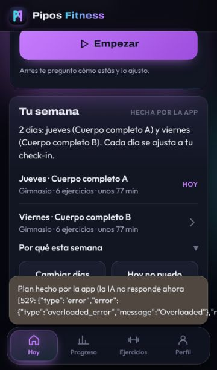

**P06 · La espera de la IA (20-90 s) no tiene progreso ni «Cancelar»** — Aud. 9 · Alta
- Evidencia [OBS]: la hoja de espera solo tiene un círculo que gira y «Suele tardar entre 20 y 90 segundos» (`cargando()` en `js/areas/entrenador/indice.js`). No hay botón para salir; el fondo está desenfocado y bloqueado.
- Por qué importa: 90 s de pie en la entrada del gimnasio sin saber si avanza; la única salida es cerrar la app.
- Captura: 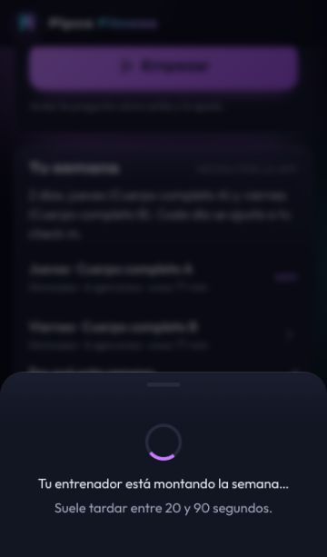

**P08 · Minutos y constancia que no cuadran entre pantallas** — Aud. 11 · Media
- Evidencia [OBS]: la auditoría confirmó que la duración y la constancia se calculan distinto en Hoy, el plan, el check-in y Progreso. En las capturas, el mismo día figura como «unos 77 min» en Hoy y en el plan, y «unos 66 min» en la vista previa del check-in tras bajar la energía, sin decir que el cambio viene del ajuste.
- Por qué importa: en M2 la persona decide si le da tiempo; una cifra que cambia según la pantalla le quita confianza en el entrenador.
- Captura: 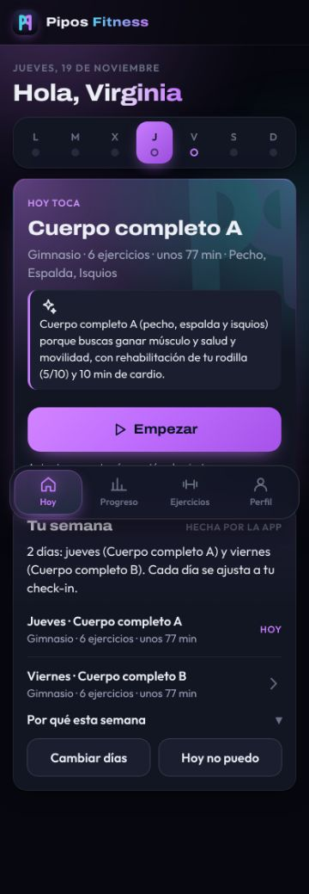 (la barra de navegación aparece a media página por ser una captura de página entera).

### 5.2 Entrada al gimnasio (M5): check-in

**P09 · El check-in vuelve arriba con cada toque** — Aud. 6 · Alta
- Evidencia [OBS]: cada cambio (energía, tiempo, lugar, dolor) vuelve a abrir la hoja entera (`hojaCheckin()` llama a `abrirHoja()` otra vez), con lo que el desplazamiento vuelve a cero y la vista previa, que está al final, se pierde de vista.
- Por qué importa: con una mano y de pie, cada salto obliga a volver a buscar dónde estaba. Es la pantalla que se usa justo al llegar.
- Captura: 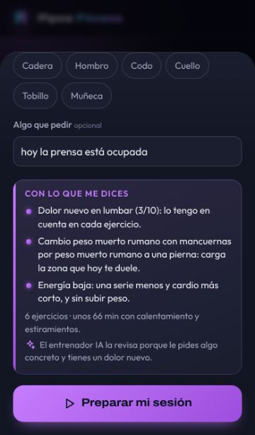

**P10 · Filas de chips que pierden la posición** — Aud. 7 · Media
- Evidencia [OBS]: las filas de chips con desplazamiento horizontal (por ejemplo, las secciones de Perfil) se repintan al tocar y vuelven al principio; el chip elegido puede quedar fuera de la vista. En Perfil, «Mis datos» se corta en «Mi» en 390 px.
- Captura: 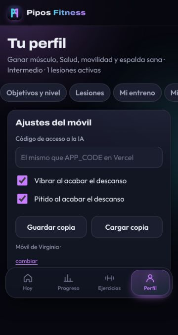

**P23 · Textos con errores y jerga** — Aud. 19 · Media
- Evidencia [OBS]: «1 lesiones activas» (concordancia); «El mismo que APP_CODE en Vercel» como ayuda del código de acceso; códigos HTTP en los avisos (P05); otros listados en la auditoría (concordancias, «e isquios», dos nombres para la misma cosa).
- Por qué importa: la jerga no ayuda a nadie que no haya desplegado la app y resta confianza.
- Captura: la misma 12.

### 5.3 Entre series y durante la serie (M6)

**P11 · Los kilos no pasan a la serie siguiente y no hay ±** — Aud. 1 · Alta
- Evidencia [OBS]: al marcar una serie solo se copian los kilos del plan si la casilla está vacía (`marcarSerie()` en `js/areas/sesion/indice.js`); lo que se tecleó en la serie 1 no llega a la 2. No hay botones + / −: cambiar los kilos es tocar el campo, esperar el teclado, borrar, escribir, cerrar el teclado y marcar. La auditoría contó **5-6 toques por serie**; con ~20 series, más de 100 toques por sesión.
- Por qué importa: es el gesto más repetido de la app, con las manos sudadas y la menor atención.
- Captura: 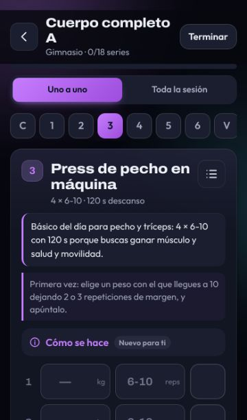

**P12 · En «Uno a uno» la primera serie queda fuera de pantalla** — Aud. 2 · Alta
- Evidencia [OBS]: la primera fila de series empieza entre y = 622 y 1025 px en pantallas de 568 a 664 px de alto: siempre hay que desplazarse para apuntar. Delante van la cabecera, la barra de progreso, el selector de modo, la tira de pasos, la tarjeta con dos notas y «Cómo se hace» abierto con vídeo.
- Captura: 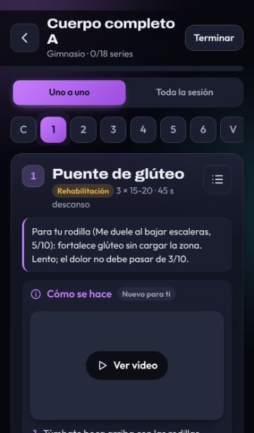

**P14 · Jerarquía débil de la tarjeta de ejercicio y adornos que recargan** — Aud. 20 · Media
- Evidencia [OBS]: el nombre del ejercicio compite con la insignia, el objetivo en texto pequeño gris, la razón y la nota en dos cajas casi iguales, y la técnica desplegada. Los datos que se usan en cada serie (kilos, repeticiones) son de los elementos más pequeños. Fondos con degradados y brillos en toda la app.
- Capturas: 05 y 06.

**P13 · Paso actual y hecho: oscuro sobre oscuro** — Aud. 10 · Media
- Evidencia [OBS]: en la tira de pasos, el paso que es a la vez actual y hecho se pinta gris oscuro sobre fondo oscuro, menos visible que los demás; justo el que importa.
- Captura: 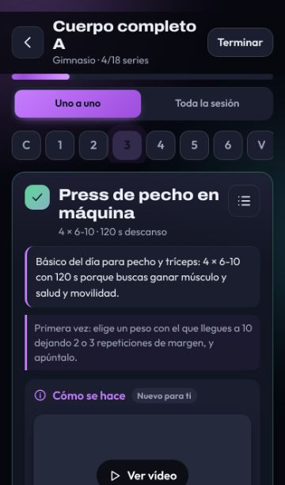

**P20 · Zonas táctiles de 23-40 px** — Aud. 15 · Alta
- Evidencia [OBS]: medidas con `getBoundingClientRect` en la auditoría: controles de 23 a 40 px (enlaces de texto, botones de icono y marcas de tareas, entre otros). El plan pide ≥ 48 px en la sesión y ≥ 44 px en el resto.

**P21 · El menú del ejercicio abre con el teclado** — Aud. 16 · Media
- Evidencia [OBS]: al abrir el menú (cambiar, añadir serie, opinar) el foco cae en el campo de comentario y en el móvil sube el teclado, que tapa la mitad de las opciones.
- Captura: 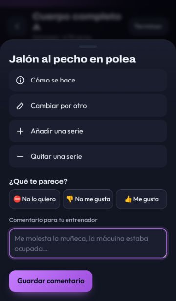

### 5.4 Descanso (M7)

**P16 · La barra de descanso tapa la última serie** — Aud. 17 · Alta
- Evidencia [OBS]: la barra fija inferior (tiempo, −15, +15, Saltar) se superpone a la última fila visible, que suele ser la serie siguiente.
- Captura: 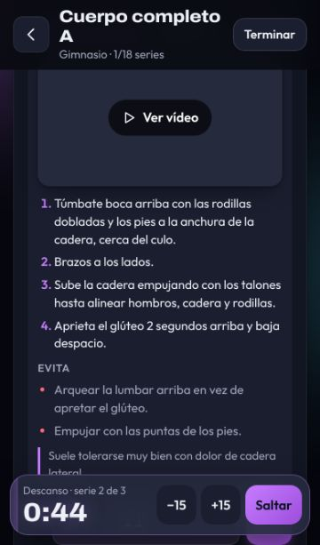

**P15 · La alarma de fin de descanso es ilegible la mitad del tiempo y pide un toque** — Aud. 3 · Alta
- Evidencia [OBS]: la pantalla de «¡A por la siguiente serie!» parpadea; en la mitad del ciclo el texto tiene un contraste de ~1,05:1 con el fondo (medido por script). No se quita sola: hay que tocarla cada vez antes de seguir.
- Por qué importa: es la pantalla que se mira de reojo y desde más lejos; y un toque extra en cada serie.
- Captura (fotograma apagado): 

### 5.5 Máquina ocupada (M8)

**P17 · Acciones con consecuencias sin aviso** — Aud. 8 · Alta
- Evidencia [OBS]: «Cambiar por otro» crea el ejercicio nuevo desde cero (`crearEjercicio`) y borra las series ya hechas del anterior, sin confirmar. «Terminar» abre el cierre sin decir cuántas series quedan. Una sesión hecha se abre con todos los campos editables.
- Por qué importa: el cambio por máquina ocupada se hace con prisa [HIP]; perder dos series hechas de un ejercicio no se puede deshacer.

### 5.6 Cardio (M9)

**P18 · El contador trata el cardio como una plancha** — Aud. 18 · Media
- Evidencia [OBS]: una bici estática de 8 min se presenta como «objetivo 480 s» con la palabra «Aguanta», igual que un isométrico.
- Captura: 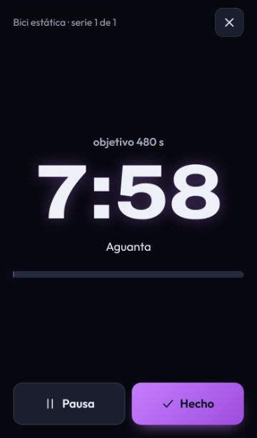

### 5.7 Después (M12): cierre

**P22 · Con el botón atrás en «Terminar», «Guardar» dice guardado y no guarda** — extra · Alta
- Evidencia [OBS]: confirmado por la auditoría: si se abre el cierre, se pulsa el botón atrás del móvil y después «Guardar sesión», aparece «¡Sesión guardada!» y la sesión no queda guardada como hecha. Está ligado a P01 (las hojas no entran en el historial).

**P24 · Una sesión sin cerrar desaparece al pasar la medianoche** — extra · Alta
- Evidencia [OBS]: Hoy solo busca la sesión de la fecha actual (`sesionDeHoy`); una sesión de ayer sin cerrar deja de verse en Hoy aunque sigue guardada.
- Por qué importa: [HIP] es fácil irse del gimnasio sin cerrar (P-13).

### 5.8 En toda la app

**P01 · Hojas inferiores sin atrás, Escape, foco ni etiqueta** — Aud. 4 · Alta
- Evidencia [OBS]: las hojas (check-in, cierre, menú, cambiar ejercicio, plan, medidas) no entran en el historial: el botón atrás del móvil navega por debajo. Escape no las cierra, no mueven el foco a su título y no tienen `aria-labelledby`.
- Capturas: 02, 11.

**P02 · Foco perdido en cada repintado** — Aud. 12 · Media
- Evidencia [OBS]: cada acción repinta la pantalla entera (`pintar()`), y el foco vuelve al documento. Con teclado o lector de pantalla se empieza de cero tras cada toque.

**P03 · Estados solo por color** — Aud. 13 · Media
- Evidencia [OBS]: la tira de la semana distingue hecho / hoy / pendiente con color y relleno de un punto; sin color (o con daltonismo, o con brillo bajo) no se distinguen. Lo mismo en algunas insignias y en los chips activos.
- Captura: 01 (tira de la semana).

**P04 · Contraste del texto terciario y de los bordes de controles bajo AA** — Aud. 14 · Alta
- Evidencia [OBS]: script de contraste de la auditoría (`contraste.js`): el texto terciario (pistas, unidades «kg» y «reps», metadatos) y los bordes de campos y botones secundarios quedan por debajo de 4,5:1 y 3:1. Los campos de kilos vacíos casi no se distinguen del fondo (captura 06).
- Por qué importa: con reflejos de fluorescentes o al sol [HIP], lo que ya está justo en la pantalla del portátil desaparece.

---

## 6. Requisitos medibles

Los heredan DIS 3 (sistema de diseño), DIS 4 (prototipos) y la fase 5. R01-R07 vienen del plan; R08-R27 los añade este estudio a partir del inventario. Todos se miden en 360×640 y 320×568 salvo que se diga otra cosa, con Playwright.

| ID | Requisito | Cómo se mide | Origen |
|---|---|---|---|
| R01 | Zonas táctiles ≥ 48 × 48 px en sesión, descanso, contador y cierre; ≥ 44 × 44 px en el resto; separación ≥ 8 px entre objetivos adyacentes | Script que recorre todos los controles visibles (`getBoundingClientRect`) en cada pantalla y estado; 0 por debajo | Plan, P20 |
| R02 | Contraste AA: texto ≥ 4,5:1 (≥ 3:1 si ≥ 24 px o ≥ 18,66 px en negrita); bordes de controles, iconos con significado y estados ≥ 3:1 | Script de contraste sobre los tokens (DIS 3) y sobre el DOM renderizado de cada pantalla; 0 pares por debajo | Plan, P04, P13 |
| R03 | Primera serie pendiente visible entera sin desplazarse en 360×640, en «Uno a uno» y al entrar en la sesión; en 320×568, al menos el nombre, el objetivo y la serie actual | Playwright: la fila de la serie actual tiene `bottom` ≤ alto del viewport menos lo que ocupe lo fijo | Plan, P12 |
| R04 | Repetir una serie con los mismos kilos y repeticiones: 1 toque. Cambiar kilos o repeticiones: ≤ 3 toques, sin teclado | Prueba e2e que cuenta los eventos de toque por serie; 0 apariciones del teclado en el caso normal | Plan, P11 |
| R05 | Kilos y repeticiones de la serie hecha pasan a las siguientes vacías del mismo ejercicio; el punto de partida es la última vez | Prueba unitaria y e2e: tras marcar la serie 1 con 22,5 kg, la 2 muestra 22,5 kg | P11 |
| R06 | Cifras de la sesión (kilos, repeticiones, tiempo de descanso) ≥ 28 px; contador a pantalla completa ≥ 64 px | Estilo computado de los elementos marcados como cifra | Plan |
| R07 | Acción principal de cada pantalla en el tercio inferior, al alcance del pulgar | Playwright: centro del botón principal con `y` ≥ 2/3 del viewport en todas las pantallas y estados | Plan |
| R08 | Alarma de fin de descanso: texto ≥ 7:1 en **todos** los fotogramas (solo se anima el fondo o la escala, nunca la legibilidad); se cierra sola (al empezar la siguiente serie o a los ≤ 10 s); recibe el foco y se anuncia | Script que captura 10 fotogramas del ciclo y mide el contraste mínimo; e2e que comprueba que desaparece sin toque | P15 |
| R09 | La barra de descanso nunca tapa la serie siguiente ni la acción principal | Playwright: intersección vacía entre la barra y la fila de la serie siguiente en todos los tamaños | P16 |
| R10 | Hojas accesibles: atrás y Escape las cierran; foco a su título al abrir y vuelta al botón que las abrió al cerrar; `role="dialog"`, `aria-modal`, `aria-labelledby`; fondo `inert` | e2e con botón atrás y solo teclado; auditoría de accesibilidad automática | P01 |
| R11 | Tras cualquier acción, el foco sigue en el mismo control (o en el siguiente lógico); al cambiar de pantalla, al `h1` | e2e: `document.activeElement` tras cada acción | P02 |
| R12 | Ningún estado depende solo del color: cada uno lleva texto, icono o forma distinta | Capturas en escala de grises y con simulación de daltonismo revisadas; nombres accesibles que incluyen el estado | P03, P13 |
| R13 | Errores de la IA en lenguaje llano, sin códigos ni JSON; se quedan hasta que se cierran; la petición y el check-in se conservan; ofrecen «Reintentar» y «Hacerla con la app» | e2e con 401, 413, 502, 529 y tiempo agotado: 0 cifras de código ni llaves en el texto; el campo de petición conserva su valor | P05 |
| R14 | Espera de la IA: progreso visible en < 1 s (por etapas o real), «Cancelar» ≥ 48 px siempre visible; cancelar devuelve al check-in intacto y no deja una petición pagando | e2e con respuesta lenta simulada | P06 |
| R15 | Check-in y formularios se actualizan en su sitio: `scrollY` no cambia más de 4 px tras cada toque | e2e: comparar `scrollY` antes y después de cada control | P09 |
| R16 | Filas con desplazamiento horizontal conservan `scrollLeft` y mantienen el elemento elegido visible; ninguna etiqueta se corta | e2e en 320 y 360 px | P10 |
| R17 | Acciones con pérdida confirman nombrando lo que se pierde («Tienes 2 series hechas de press de banca»), o lo conservan; «Terminar» dice cuántas series y tareas quedan; la sesión hecha se abre en modo lectura (0 campos editables) con «Editar» explícito | e2e de cada caso | P17 |
| R18 | El cardio y lo que dura ≥ 2 min se muestran en minutos (mm:ss), con su propio texto (sin «Aguanta»); la unidad del objetivo es la del ejercicio | e2e con un ejercicio de «8 min»: no aparece «480 s» | P18 |
| R19 | Una sola fuente para minutos y constancia: el mismo día muestra la misma cifra en Hoy, plan, check-in y Progreso (y si el check-in la cambia, lo dice) | Prueba que compara los textos de las cuatro pantallas con datos sembrados | P08 |
| R20 | No se pierde lo hecho: una sesión sin cerrar sigue en Hoy después de la medianoche; «Guardado» solo aparece si el guardado se ha comprobado | Pruebas T4 del plan (medianoche, atrás en el cierre) | P22, P24 |
| R21 | Sin cobertura, la sesión entera funciona; lo que necesita red aparece desactivado con su motivo, nunca un error | Playwright en modo avión (T5 del plan) | M4-M5 |
| R22 | Textos sin jerga técnica (`APP_CODE`, «Vercel», códigos HTTP, JSON) ni errores de concordancia; un nombre para cada cosa | Lista de términos prohibidos comprobada por script sobre el texto de todas las pantallas; revisión con `design:ux-copy` | P23 |
| R23 | Ninguna hoja abre el teclado al abrirse, salvo que su único propósito sea escribir | e2e: tras abrir cada hoja, `activeElement` no es un campo de texto | P21 |
| R24 | Con texto al 200 % y en 320 px no hay desplazamiento horizontal ni texto cortado | `scrollWidth ≤ clientWidth` en todas las pantallas con zoom de texto | Auditoría (capturas x-texto200) |
| R25 | Con movimiento reducido, la misma información sin animación (celebraciones, transiciones y alarma incluidas); durante una serie no se mueve nada salvo el contador | e2e con `prefers-reduced-motion: reduce`; revisión de capturas | Plan |
| R26 | Tarjeta de ejercicio: lo que se usa en cada serie (nombre, serie actual, kilos, repeticiones, marcar) va antes que lo explicativo; la técnica se pliega si el ejercicio ya se ha hecho alguna vez y no empuja las series fuera de la vista | Orden del DOM y posición; ligado a R03 | P12, P14 |
| R27 | Protección contra el doble toque en marcar serie, terminar y guardar: dos toques en < 400 ms cuentan como uno | e2e con dos clics seguidos | Plan, PR 15 |

**Notas para DIS 3:**

- R02 y R08 piden que el sistema tenga, además del texto terciario, un nivel de texto pensado para leerse de lejos y con reflejos (H5).
- R04 pide un componente propio de selector ± para kilos (con el paso de la máquina: 1, 2,5 o 5 kg) y otro para repeticiones (P-6).
- R12 pide que el color por persona (D11) nunca sea el único portador de un estado.

---

## 7. Hipótesis principales y preguntas abiertas

### 7.1 Hipótesis que más condicionan el diseño

Ordenadas por cuánto cambiaría el diseño si fueran falsas. «Estado» se actualiza tras el diario: *abierta / confirmada / tumbada / matizada*.

| ID | Hipótesis | Si es falsa… | Pregunta | Estado |
|---|---|---|---|---|
| H1 | Entre series el móvil se usa con una mano, de pie, en miradas de 1-2 s, y la mayor parte del tiempo está fuera de la mano (banco, suelo, bolsillo) | Si se sostiene todo el rato, pesa menos el aviso sin mirar y más la densidad de información | P-4, P-5 | Abierta |
| H2 | Lo que se mira entre series es, por orden: cuánto queda de descanso, qué serie toca y con cuántos kilos, y los kilos de la última vez | Cambia lo que va en el nivel de 1 s de la sesión | P-4 | Abierta |
| H3 | El check-in casi siempre se deja como viene (lo previsto) y solo se toca energía o dolor | Si se usa mucho la petición libre, el campo merece más sitio y la espera de la IA es más frecuente | P-3 | Abierta |
| H4 | El fin del descanso se nota por sonido o vibración, no mirando; con auriculares el pitido se oye mezclado con la música | Si no se oye ni se nota, la alarma visual pasa a ser la principal y necesita más presencia | P-7 | Abierta |
| H5 | La luz del gimnasio (fluorescentes, reflejos, a veces brillo bajo) hace ilegibles los textos tenues y los degradados | Si no molesta, los requisitos de contraste se quedan en AA sin el nivel extra | P-8 | Abierta |
| H6 | Progreso, Perfil y Ejercicios se usan sobre todo en casa, sentados y con calma | Si se miran en el gimnasio, necesitan la misma legibilidad que la sesión | P-14 | Abierta |
| H7 | En la piscina el móvil se queda en la taquilla: se mira antes y se apunta todo después | Si se lleva al borde (funda), el modo piscina necesita controles enormes y nada de teclado | P-11 | Abierta |
| H8 | La máquina ocupada es frecuente y se resuelve cambiando el orden más que cambiando el ejercicio | Si se cambia el ejercicio, «Cambiar por otro» tiene que estar a un toque; si se cambia el orden, hace falta «hacer este más tarde» | P-9 | Abierta |
| H9 | A veces no hay cobertura en el vestuario o en la sala | Si siempre hay, la espera y el fallo de la IA son menos críticos (pero siguen pasando) | P-2 | Abierta |
| H10 | Es fácil irse sin cerrar la sesión (se apunta la última serie y se guarda el móvil) | Si siempre se cierra, el estado «sesión de ayer sin cerrar» es raro (pero no se puede perder) | P-13 | Abierta |
| H11 | El cardio se hace con el móvil apoyado en la máquina, mirando el tiempo de lejos | Si se usa el reloj de la máquina, el contador de cardio pasa a segundo plano | P-10 | Abierta |
| H12 | La técnica («Cómo se hace») se consulta solo la primera vez o dos | Si se consulta a menudo, merece un acceso fijo y rápido en la tarjeta | P-12 | Abierta |

### 7.2 Preguntas que el diario debe responder

Las preguntas de la plantilla (`diario-plantilla.md`) están pensadas para responderlas; aquí va qué buscamos con cada una.

| ID | Pregunta | Qué decide | Pregunta del diario |
|---|---|---|---|
| P-1 | ¿Cuándo y dónde se mira qué toca: la noche antes, en casa al salir, al llegar? | Peso de Hoy frente a la sesión; si hace falta un resumen previo | 1 |
| P-2 | ¿Hay cobertura en el vestuario y en la sala? | Prioridad del modo sin red y del fallo de la IA | 5 |
| P-3 | ¿Qué se cambia en el check-in y cuánto se usa la petición libre? | Valores por defecto; sitio del campo de petición | 4 |
| P-4 | Entre series, ¿qué se mira en la app? | Nivel de 1 s de la sesión | 3 |
| P-5 | ¿Dónde está el móvil entre series (mano, bolsillo, banco, suelo, soporte)? | Tamaño de las cifras; aviso sin mirar | 2 |
| P-6 | ¿Cuánto cambian los kilos entre series y de qué en qué (1, 2,5, 5 kg)? | Paso del selector ± | 4 |
| P-7 | ¿Se usan auriculares? ¿Se oye el pitido o se nota la vibración al acabar el descanso? | Peso de la alarma visual | 5 |
| P-8 | ¿Cómo se ve la pantalla con la luz del gimnasio? ¿Manos sudadas, guantes, tiza? | Contraste extra; tamaño y separación de los controles | 5 |
| P-9 | ¿Pasa lo de la máquina ocupada? ¿Qué se hace entonces? | Diseño de «cambiar» frente a «más tarde» | 7 |
| P-10 | En el cardio, ¿dónde está el móvil y se mira el contador de la app o el de la máquina? | Diseño del contador de cardio | 2, 3 |
| P-11 | En la piscina, ¿dónde se queda el móvil y cuándo se apunta? | Modo piscina | 2, libre |
| P-12 | ¿Se abre «Cómo se hace» o el vídeo? ¿Cuándo? | Peso de la técnica en la tarjeta | 3 |
| P-13 | ¿Se cierra la sesión al acabar o se queda abierta? ¿Dónde se rellena el cierre? | Recuperación de sesiones sin cerrar; tamaño del cierre | 1, libre |
| P-14 | ¿Se mira Progreso, Perfil o Ejercicios? ¿Dónde y cuándo? | Legibilidad de esas pantallas | libre |
| P-15 | ¿Qué sobra y qué falta en la pantalla? | Recortes y huecos que no hemos previsto | 6 |
| P-16 | ¿Cuánto estorba la app en una sesión (1-5)? | Línea base para comparar con los prototipos de DIS 4 | 8 |

---

## 8. Siguientes pasos

1. Víctor y Virginia rellenan `diario-plantilla.md` tras 3-4 sesiones reales cada uno y dejan las respuestas como comentario en el PR de diseño.
2. Advocate sintetiza los diarios: agrupa por tema, separa lo observado de lo interpretado, actualiza la columna «Estado» de 7.1 y ajusta la sección 3, la jerarquía (4) y los requisitos (6) donde haga falta. Lo que siga sin respuesta queda como hipótesis explícita.
3. Con tu OK, empieza DIS 2 (identidad) con los requisitos de la sección 6 como restricciones.

### Capturas incluidas

| Archivo | Muestra | Problemas |
|---|---|---|
| `capturas-actuales/01-hoy-con-plan.jpg` | Hoy con plan (página entera) | P03, P08 |
| `capturas-actuales/02-checkin-previa.jpg` | Check-in con la vista previa | P09 |
| `capturas-actuales/03-espera-ia.jpg` | Espera de la IA | P06 |
| `capturas-actuales/04-fallo-ia.jpg` | Aviso de fallo de la IA | P05, P23 |
| `capturas-actuales/05-uno-a-uno-series-fuera.jpg` | «Uno a uno» al entrar en un ejercicio | P12, P14 |
| `capturas-actuales/06-series-kg-sin-mas-menos.jpg` | Filas de serie con kilos | P11, P04 |
| `capturas-actuales/07-barra-descanso-tapa.jpg` | Barra de descanso | P16 |
| `capturas-actuales/08-alarma-fin-descanso.jpg` | Alarma en el fotograma de bajo contraste | P15 |
| `capturas-actuales/09-paso-actual-hecho.jpg` | Tira de pasos, paso actual y hecho | P13 |
| `capturas-actuales/10-cardio-objetivo-480s.jpg` | Contador de una bici estática | P18 |
| `capturas-actuales/11-menu-ejercicio-teclado.jpg` | Menú del ejercicio | P21, P01 |
| `capturas-actuales/12-perfil-chips-textos.jpg` | Perfil, ajustes | P10, P23 |
